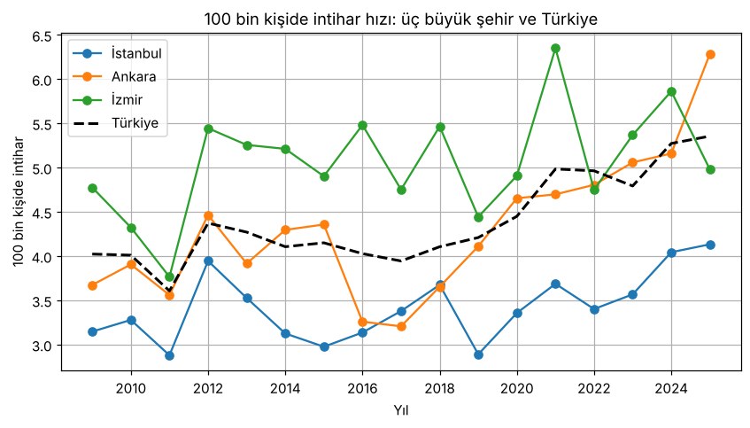
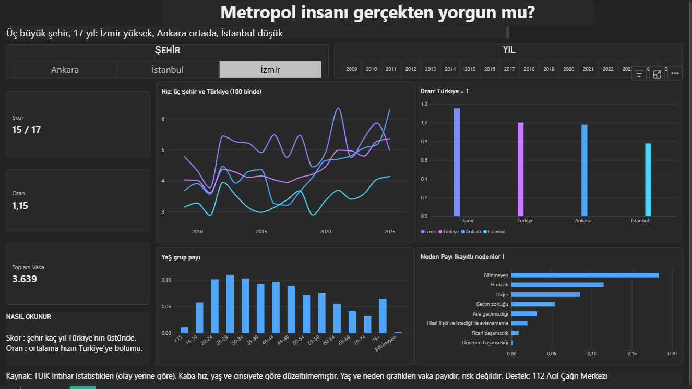

# Metropol İnsanı Gerçekten Yorgun mu? İstanbul, Ankara ve İzmir (2009-2025)

TÜİK verileriyle İstanbul, Ankara ve İzmir'in 2009-2025 kaba intihar hızlarını Türkiye ortalamasıyla karşılaştıran tanımlayıcı bir veri analizi projesi. Analiz Python'da (pandas, numpy, matplotlib), etkileşimli rapor Power BI'da hazırlandı; iki araçta bulunan sonuçlar birbirini doğruladı.

Makale: [Medium](https://medium.com/@arzucankurt719/metropol-i%CC%87nsan%C4%B1-ger%C3%A7ekten-yorgun-mu-%C3%BC%C3%A7-b%C3%BCy%C3%BCk-%C5%9Fehrin-i%CC%87ntihar-h%C4%B1z%C4%B1na-veriyle-bakmak-f9627c49cf33) | Rapor: [proje_raporu.pdf](proje_raporu.pdf)

**Hipotez:** "Anadolu durgun, metropol insanı yorgun": İstanbul'un kaba intihar hızı Türkiye'den belirgin şekilde yüksektir.

## Bulgular

- **İstanbul için hipotez çürütüldü.** İstanbul'un hızı 17 yılın 17'sinde Türkiye'nin altında (ortalama 3,42 ve 4,39).
- **Metropol tek bir hikâye anlatmıyor.** İzmir 17 yılın 15'inde Türkiye'nin üstünde (ortalama 5,06), Ankara Türkiye düzeyinde (4,30), İstanbul üç şehrin en düşüğü.
- **Cinsiyet:** Vakaların yaklaşık %78'i erkek; erkek/kadın oranı 2,7 ile 4,5 arasında dalgalanıyor.
- **Yaş:** Vakalar en çok 25-29 yaşta yoğunlaşıyor (vaka payıdır, risk oranı değildir).
- **Neden:** TÜİK'in kayda geçirdiği nedenler arasında hastalık, 17 yılın 17'sinde ilk sırada (nedeni belli vakaların yaklaşık %58'i). Vakaların yaklaşık %56'sı "diğer" ya da "bilinmeyen" olarak kayıtlı, bu yüzden nedenle ilgili yorumlar temkinlidir.



## Power BI raporu

Veri modeli yıldız şemasıdır (3 olgu, 4 boyut tablosu); DAX ölçüleri ve tek sayfalık etkileşimli rapor `istanbul_metropol.pbix` dosyasındadır.



## Dosyalar

| Dosya | Açıklama |
|---|---|
| `proje_raporu.pdf`, `proje_raporu.md` | Proje raporu: konu, hipotez, kaynaklar, veri sözlüğü, dosya açıklamaları |
| `makale.pdf` | Medium makalesinin PDF kopyası |
| `istanbul_metropol.pbix` | Power BI dosyası: Power Query, veri modeli, DAX, rapor |
| `gorseller/` | Rapor ve README'de kullanılan görseller |
| `istanbul_intihar_analiz.ipynb` | Ana analiz defteri (açıklamalar + kod + grafikler) |
| `veri_olustur.py` | 4 Excel dosyasından CSV üretir |
| `istanbul_intihar_2009_2025.csv` | Analizde kullanılan birleşik veri (17 satır, 32 sütun) |
| `il_ve_cinsiyete_gore_intiharlar.xlsx` | TÜİK ham tablo: cinsiyet |
| `illere_gore_kaba_intihar_hizi.xlsx` | TÜİK ham tablo: kaba hız (İstanbul, Ankara, İzmir, Türkiye kullanıldı) |
| `il_ve_yas_grubuna_gore_intiharlar.xlsx` | TÜİK ham tablo: yaş grubu |
| `il_ve_nedene_gore_intiharlar.xlsx` | TÜİK ham tablo: neden |

## Çalıştırma

```
pip install pandas numpy matplotlib openpyxl jupyter
python veri_olustur.py      # CSV'yi yeniden üretir (isteğe bağlı)
jupyter notebook            # istanbul_intihar_analiz.ipynb dosyasını açıp Run All
```

## Kaynak ve notlar

Kaynak: TÜİK İntihar İstatistikleri (https://veriportali.tuik.gov.tr/tr/press/58233), olay yerine göre tablolar.
Kaba hız yaş ve cinsiyete göre standartlaştırılmamıştır. Yaş ve neden sonuçları vaka payıdır, risk oranı değildir.
Bu çalışma tanımlayıcıdır; nedensellik iddia etmez.

Kendiniz ya da çevrenizde biri için destek arıyorsanız 112 Acil Çağrı Merkezi'ni arayabilirsiniz.
